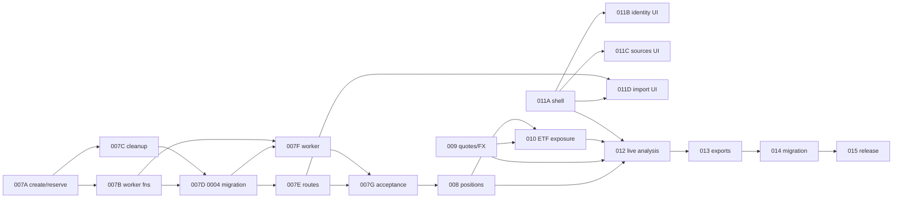
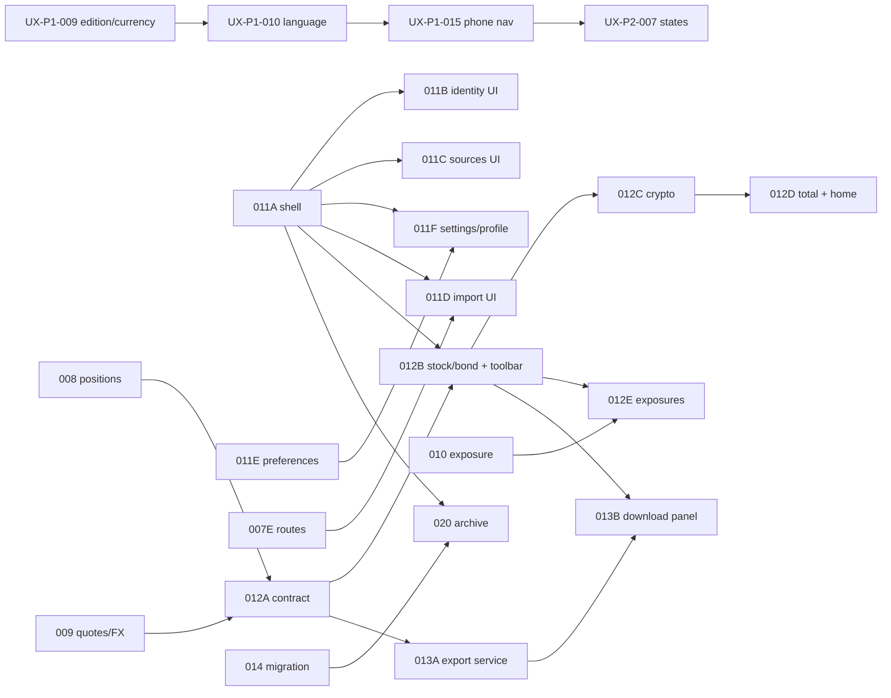

# End-to-end roadmap

Kurafolio V2 turns the current single-owner SQLite app into a registered,
tenant-isolated PostgreSQL product with live analysis, ephemeral CSV imports and
on-demand exports. The current CLI and Web app stay usable throughout. This page
orders the work. Each ticket file holds its own scope, acceptance and handoff;
`python3 scripts/tickets.py list` is the live status.

Updated 2026-11-13 (triage; see the next two sections). Phases describe sequencing, not approval. Tickets with
`gate: owner` still need the owner's approval before work starts. The sections from "Phases" onward
are the history of earlier planning passes; where they disagree with the triage, the triage is current.

## Where things stand (2026-11-13)

- The board holds 118 tickets: 41 done or superseded, 77 open (35 P0, 23 P1, 19 P2).
- A user can register, sign in, manage invitations and enable sources in the V2 shell
  (WL-P0-011A, 011B, 011C, 011G). No V2 screen shows an import or a value yet.
- The import database functions are complete (WL-P0-007A, B, C, I, J, L). WL-P0-007D, the migration that
  installs them, is being worked and is the single ticket every other MVP ticket waits on.
- The quote adapter contract is merged (WL-P0-009A). WL-P0-009E, the official provider, is half done and
  waits for the owner to supply provider keys for the probe.
- The project is renamed (WL-P0-024) and the import SQL tests run in CI (WL-P0-022).

## Triage of 2026-11-13

What changed on the board is in each ticket's Log. In short: board drift fixed (WL-P0-017 done, WL-P0-019
superseded, epics and stale handoffs corrected, WL-P0-015 now depends on real tickets instead of epics that
nothing closes); WL-P0-007E, 007F and 007G gained the concrete routes, rules and cases from the approved
contract; every thin P1 and P2 ticket was rewritten to stand on its own; eight tickets were added
(WL-P1-015 to WL-P1-020, WL-P2-010, WL-P2-011); WL-P1-001 moved to P2 and WL-P2-009 to P1.

### Step 1: a V2 MVP the owner can use (11 tickets)

The owner's flow works end to end: register, enable plugins, import, see Stock/Bond, Crypto and Total.

| Order | Ticket | What it delivers | Tier | Waits on |
|---|---|---|---|---|
| 1 | WL-P0-007D | Installs the import functions on an instance | frontier | in progress |
| 2 | WL-P0-007E | The import routes the browser calls | frontier | 007D |
| 2 | WL-P0-007F | The worker that parses uploaded files in isolation | frontier | 007D |
| 2 | WL-P0-008 | Positions from accepted imports, with the owner's rules | frontier | 007D |
| 3 | WL-P0-011D | Import Data page: upload, review, confirm, history | standard | 007E |
| 3 | WL-P0-012A | One analysis contract for securities, crypto and total | frontier | 008 |
| 4 | WL-P0-012B | Stock/Bond page and the shared toolbar | standard | 012A |
| 4 | WL-P0-021 | One-command deployment; its pull request says "ready to use" | frontier | 007E, 007F, 012A |
| 5 | WL-P0-012C | Crypto page | standard | 012B |
| 5 | WL-P0-007G | Independent acceptance of imports (36 cases) | frontier | 007E, 007F |
| 6 | WL-P0-012D | Total page and Home | standard | 012C |

Tickets with the same order number share no resource and can run at the same time. In the MVP,
securities are valued from the import's own market values or the optional unofficial adapter, Bitcoin
from the live price, in CAD, USD and TWD.

### Step 2: V2 go-live (17 more tickets)

WL-P0-015 is the go-live gate. Its `depends_on` is this list.

| Order | Ticket | What it delivers | Tier | Waits on |
|---|---|---|---|---|
| any | WL-P0-011E, then 011F | Language, time zone and currency saved per user; Settings and Profile pages | frontier, standard | 007D frees the migration lock |
| any | WL-P0-007N | A failing cleanup no longer starves other imports | frontier | 007D frees the SQL lock |
| any | WL-P0-007M | Decision: retrying an upload whose previous attempt is stuck | frontier | 007D frees the SQL lock; then the owner |
| any | WL-P0-009E | Official price provider with the operator's own key | frontier | owner supplies keys; then the owner chooses |
| 1 | WL-P0-009B | Stored prices, scheduled and manual refresh | frontier | 012A |
| 1 | WL-P0-011H | Pages offer "Enable a source" only when it applies | standard | 012A |
| 1 | WL-P0-013A | Downloads rendered on demand: PDF, Excel, ODS, Markdown | frontier | 012A |
| 2 | WL-P0-009C | Twelve display currencies with daily rates | frontier | 009B |
| 2 | WL-P0-010A | Fund holdings stored and refreshed for held funds | frontier | 009B |
| 2 | WL-P0-013B | Download panel on every analysis page | standard | 013A, 012B |
| 2 | WL-P0-023 | Real end-to-end browser suite in CI | frontier | 011D, 007F, 012B |
| 3 | WL-P0-009D | Daily value line, with estimated days marked | frontier | 009B, 009C |
| 3 | WL-P0-010B, then 012E | Exposure analysis and the Exposures page | frontier, standard | 010A, 012A; then 012B |
| 3 | WL-P0-014 | Fresh-start guide from the old application | standard | 021, 012D |
| 4 | WL-P0-015 | Release acceptance on the owner's platform; closes the epics | frontier | all of the above |

WL-P0-016 (publish the planning package) is P0 without an approval. The tickets no longer need it to be
workable; WL-P0-015 needs the golden cases it contains. The owner decides whether to approve or drop it.

### Step 3: after go-live

P1, in recommended order. All are `backlog` until the owner approves each one.

| Group | Tickets | Why this order |
|---|---|---|
| Before inviting anyone else | WL-P1-018 security review, WL-P2-009 dependency scanning (now P1), WL-P1-019 access from other devices, WL-P1-017 user administration and the registration switch, WL-P0-011I invitation status | The instance holds several people's financial records |
| Learn from real use | WL-P1-020 feedback review, WL-P1-016 recovering from a wrong import, WL-P1-007 time zone contract | The owner's use decides the rest |
| Deeper analysis | WL-P1-002 look up any ETF, UX-P1-005 holding detail, WL-P1-004 why the value changed, UX-P1-004 targets and drift, WL-P1-015 fund overlap, WL-P1-014 more export formats | Each needs only data that exists at go-live |
| Reach other users | WL-P1-003 contributor guide and harness, UX-P1-007 published images | Other households can install it and add their broker |
| Agent workflow, any time | WL-P1-012 flaky test (claimable now), WL-P1-006 (stale claim), WL-P1-010 faster CI, WL-P1-008 and 009 board check and owner inbox, WL-P1-011 CI reviewer, WL-P1-005 path check | They speed up everything else |

P2:

| Group | Tickets | Note |
|---|---|---|
| One decision gates six tickets | WL-P2-002, then UX-P1-001, UX-P1-002, UX-P1-003, UX-P2-001, UX-P2-005 | Whether to record transactions: contributions, rate of return, income, benchmarks, tax evidence |
| More institutions | WL-P2-001 (epic), WL-P1-001 API connector (moved from P1) | After WL-P1-003 |
| Smaller enhancements | WL-P2-011 fund costs, UX-P2-003 hide balances and phone polish, UX-P2-002 goal scenarios, WL-P2-004 French, UX-P2-004 status page, WL-P2-010 two-factor sign-in, WL-P2-007 demo instance | Independent of each other |
| Housekeeping | WL-P2-006 lint gate, WL-P2-008 retire old import paths, WL-P0-020 legacy archive (optional) | |
| Proposed for closure | WL-P2-005 folder-watch imports | No request on record |

### What only the owner can do now

1. Supply the provider keys for WL-P0-009E, or tell an agent where they are. Its Handoff has the steps.
2. Approve or drop WL-P0-016.
3. Say whether WL-P1-006's stale claim may be taken over; it has uncommitted work in its worktree.
4. Approve WL-P1-010 (faster CI) and its two decisions, now that several branches are open at once.
5. Answer WL-P1-011's three questions if a CI reviewer is wanted.
6. Confirm or reverse the two priority changes of this triage (WL-P1-001 to P2, WL-P2-009 to P1), the
   proposal to close WL-P2-005, and the eight new tickets.

## Phases

| Phase | Outcome | Tickets |
|---|---|---|
| 0. Enable parallel agents | Tracked tickets, claims, isolated test ports, public specs | WL-P0-017, WL-P0-018, WL-P0-016, WL-P1-006 |
| 1. Import backend | V2 imports work end to end on a synthetic instance | WL-P0-007A → 007B, 007C → 007D → 007E, 007F → 007G; 007H in parallel |
| 2. Valuation inputs | Positions, quotes, FX, ETF exposure | WL-P0-009 (can start now), WL-P0-008 (after 007), WL-P0-010 |
| 3. V2 UI | Eight-route app, identity/source/import/settings screens | WL-P0-011A → 011B, 011C, 011F; 011E and 011G in parallel; 011D (after 007E) |
| 4. Live analysis and exports | Analysis pages on canonical facts, on-demand downloads | WL-P0-012A → 012B → 012C → 012D, 012E (after 010); WL-P0-013A → 013B |
| 5. Move and release | Fresh-start guide, release gates, docs | WL-P0-014, WL-P0-015 |
| 6. P1 growth | First API connector, ETF search, plugin authoring, drilldowns, pull-only install | WL-P1-001 to WL-P1-005, UX-P1-004, UX-P1-005, UX-P1-007 |
| 7. P2 extensions | More institutions, optional financial modes, brand, locales, scheduling, UX-P2 | WL-P2-001 to WL-P2-005, UX-P1-001 to UX-P1-003, UX-P2-001 to UX-P2-005 |

## Parallel lanes

Tickets in different lanes share no exclusive resource, so different agents can
work them at the same time. Inside a lane, work is sequential.

| Lane | Resource | Now | Next |
|---|---|---|---|
| Ingestion SQL | `ingestion-schema-sql` | WL-P0-007A | 007B, 007C, 007D |
| Ingestion review | none | WL-P0-007H | 007G later |
| Market data | `market-contract`, `currency-policy` | WL-P0-009 (after OD-04 + gate) | WL-P0-010 |
| Frontend shell | `frontend-shell`, `frontend-i18n` | WL-P0-011A (after gate) | WL-P0-012 |
| Frontend screens | `frontend-identity-ui`, `frontend-sources-ui` | after 011A | 011B and 011C in parallel |
| Docs/specs | `public-docs-specs` | WL-P0-016 (after gate) | |
| Test harness | `browser-test-harness`, `test-harness` | WL-P0-018, WL-P1-006 | |

A sensible split for four agents today:

- Frontier model A (for example Claude or Codex): WL-P0-007A, then 007B.
- Frontier model B, a different session: WL-P0-007H independent review.
- Standard model: WL-P0-011A once approved, or WL-P1-006.
- Fast model such as DeepSeek Flash: WL-P0-018, then other `any`-tier chores.

## Owner actions that unlock more parallel work

1. Approve WL-P0-017 (this workflow) and WL-P0-016 (publish sanitized specs).
   Without 016, agents on other machines cannot read the detailed specs.
2. Answer WL-P0-007C cleanup-lease questions.
3. Gate A for WL-P0-011 (UI shell and screens) to open the frontend lane.
4. Decide OD-04 market-data providers and gate WL-P0-009.
5. Later: OD-02 (legacy mapping) for 014, OD-11 (platforms) for 015, OD-07 (first API) for WL-P1-001.

## Priority changes in this plan

- The open UX-P1 activity, performance and income tickets moved to P2. V2's
  approved Option A is acquisition-only. Contributions, returns and income need the
  WL-P2-002 mode decision first.
- UX-P1-006 is superseded by WL-P0-011C and WL-P1-003.
- New tickets: WL-P0-007A to H (split of 007), WL-P0-011A to D (split of 011),
  WL-P0-016 (publish specs), WL-P0-017 (this workflow), WL-P0-018 and WL-P1-006
  (parallel-agent test hygiene), WL-P1-005 (re-scope UX P1 for V2), WL-P2-004
  (locales, from I18N-007) and WL-P2-005 (scheduled imports).
- TODO.md items map as follows. FUT-002 goes to WL-P0-012, FUT-003 to UX-P1-005,
  FUT-004 to UX-P1-004 and WL-P1-004, and FUT-005 to WL-P1-004. WEB-008 goes to
  UX-P1-007, platform acceptance to WL-P0-015, the formal legacy restore command
  to WL-P0-014, cash-flow items to WL-P2-002, other adapters to WL-P2-001 and
  off-device backups to UX-P2-004.

## UI/UX backlog pass (2026-11-10)

A screen-by-screen inventory of the shipped application and the planned V2
screens is in [UX_FEATURE_INVENTORY.md](UX_FEATURE_INVENTORY.md). The tickets it
produced, the tickets it improved and the execution batches are in
[TICKET_CHANGES.md](TICKET_CHANGES.md). All new tickets are `backlog` until the
owner releases them.

| Track | Outcome | Tickets |
|---|---|---|
| Shipped application | Fix what users meet today, independent of V2 | UX-P1-008 to UX-P1-015; UX-P2-006 to UX-P2-008 |
| V2 identity and settings | Preferences, Settings and Profile, bundle serving | WL-P0-011E, 011F, 011G |
| V2 analysis | One read contract and one ticket per page | WL-P0-012A to 012E (WL-P0-012 is now their epic) |
| V2 exports | Render service and download panel | WL-P0-013A, 013B (WL-P0-013 is now their epic) |
| V2 archive | Earlier reports readable after cutover | WL-P0-020 |
| Decisions | Delivery order; time zone contract | WL-P0-019; WL-P1-007 |
| Workflow and tooling | Board check, owner inbox, lint, demo, import-path retirement | WL-P1-008, WL-P1-009; WL-P2-006 to WL-P2-008 |

## V2 MVP first (owner decision, 2026-11-10)

The owner wants a usable V2 as early as possible and will give feedback from
real use. The shipped SQLite application is not changed any more. The MVP is the
shortest path through the owner's flow: sign in, enable plugins, import, see
securities, crypto and total. Context: [PRODUCT_CONTEXT.md](PRODUCT_CONTEXT.md).

| Order | Tickets | Note |
|---|---|---|
| 1 | WL-P0-007C (with 007K), then 007L, then 007D | Serial SQL lane; waits on the 007C answers |
| 1 | WL-P0-011G, WL-P0-011A | In parallel with the SQL lane, after Gate A |
| 2 | WL-P0-007E and WL-P0-007F | In parallel with each other |
| 2 | WL-P0-011B, WL-P0-011C | In parallel, after 011A |
| 3 | WL-P0-008 | Positions, with the 2026-11-10 decisions |
| 3 | WL-P0-011D | After 007E |
| 3 | WL-P0-009A | Quote adapter contract and the optional unofficial adapter; parallel with 008 |
| 4 | WL-P0-012A (first version), then 012B, 012C, 012D | Securities valued from the import's own market values, or live quotes where WL-P0-009A is enabled; Bitcoin from the existing live price; CAD, USD and TWD from the existing daily FX |
| 5 | WL-P0-021, WL-P0-007G | Deployable instance; independent acceptance |

WL-P0-022 (import SQL tests in CI) is ready and should merge before WL-P0-007D
and 007N change more import SQL.

After the MVP, planned in detail and approved by the owner on 2026-11-11 and
2026-11-12 (WL-P0-011E, 011F, 011H, 012E, 013A, 013B, 023):

| Order | Tickets | Note |
|---|---|---|
| 1 | WL-P0-009B | Market store, refresh process, Refresh route. After 009A and 012A |
| 1 | WL-P0-009E | Official provider spike and adapter. Parallel with everything else in this table |
| 1 | WL-P0-011E, then 011F | Preferences, Settings and Profile |
| 1 | WL-P0-011H | Pages decide "Enable a source" from declared asset classes and holdings. After 012A |
| 2 | WL-P0-009C | Currency list and daily FX. After 009B |
| 2 | WL-P0-010A | Fund holdings store. After 009B; parallel with 009C |
| 3 | WL-P0-009D | Daily value curve. After 009B and 009C |
| 3 | WL-P0-010B, then 012E | Exposure endpoint, then the page |
| 3 | WL-P0-013A, then 013B | Downloads: PDF, Excel, ODS and Markdown |
| 4 | WL-P0-014 | Fresh-start guide and its test |
| 4 | WL-P0-023 | Real V2 browser suite in CI. After the MVP pages; WL-P0-015 depends on it |
| 5 | WL-P0-015 | Release acceptance on an Apple Silicon Mac with Docker Desktop |

Owner decisions of 2026-11-11: existing SQLite data is not migrated. A V2 account
starts empty and the user imports their files again; the old application stays
untouched for old reports, so WL-P0-020 is P2. The daily curve carries the
previous import's quantities forward and marks those days as estimates.

P1 and P2 tickets are refined after the owner has used the MVP.

### Rename first (owner decision, 2026-11-11)

WL-P0-024 renames the project to Kurafolio in the repository, on GitHub and on the owner's
computer. It touches about 290 files, so it is merged before any other V2
branch is opened: WL-P0-007C, 007J, 009A, 011A, 011G and 022 depend on it. It
is ready and is the only claimable V2 ticket. One agent works it alone.

Reviews are automatic from 2026-11-11: the implementing agent starts fresh
QA, Architect and PM reviewers itself ([README.md](README.md), Reviews rule),
and the owner reviews last. WL-P1-011 adds a reviewer in CI.

### MVP release state and assignment (2026-11-10)

The owner approved Gate A for the eighteen MVP tickets, answered WL-P0-007C's
six questions and folded WL-P0-007K into it. They are `ready`; `tickets.py next`
offers each one as soon as its dependencies are done.

Claimable after WL-P0-024 is merged: WL-P0-007C, WL-P0-007J, WL-P0-009A, WL-P0-011A, WL-P0-011G, WL-P0-022.
WL-P0-007C and WL-P0-007J share `ingestion-schema-sql` and run one after the
other; the rest share nothing, so four agents can start at once.

| Lane | Order | Tier | Suggested agent |
|---|---|---|---|
| Import SQL (`ingestion-schema-sql`) | 007C, then 007L, then 007D | frontier | one strong agent for the whole lane |
| Import services | 007E and 007F after 007D | frontier | two agents in parallel |
| Market data | 009A | frontier | any frontier agent |
| Bundle serving | 011G | frontier | any frontier agent |
| Shell and screens | 011A, then 011B and 011C in parallel, 011D after 007E | standard | a standard or frontier agent |
| Positions and analysis contract | 008 after 007D, then 012A | frontier | one agent |
| Analysis pages | 012B, 012C, 012D in sequence | standard | one agent, after 011A and 012A |
| Deployment and acceptance | 021; 007G by a session that implemented none of 007A to 007F | frontier | separate sessions |

Every ticket has `review: independent`: a different agent session reviews each
diff against the acceptance criteria before the owner merges.

All MVP decisions are answered as of 2026-11-10: WL-P0-007J option (b), one
bundle served by the V2 application (WL-P0-011A, 011G), and the unofficial
adapter off by default with its endpoint approved after a spike (WL-P0-009A).

CI and regression: see [CI_E2E_ASSESSMENT.md](CI_E2E_ASSESSMENT.md). WL-P0-022
(run the import SQL tests in CI) should merge before the import SQL changes;
WL-P0-023 adds a real V2 end-to-end suite; WL-P1-010 and WL-P2-009 follow.
