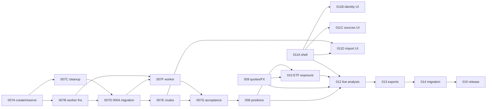
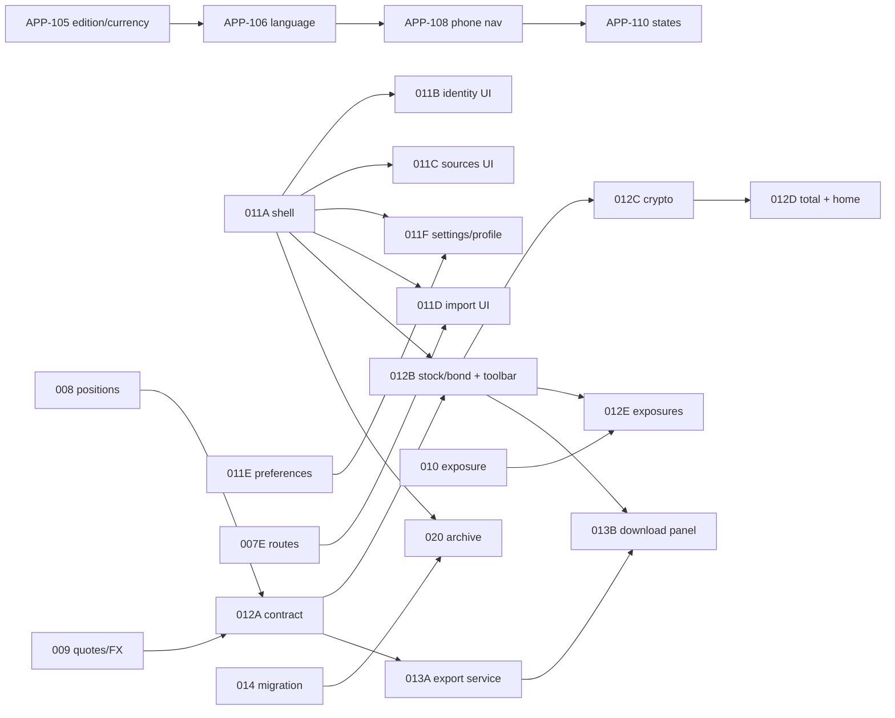

# End-to-end roadmap

Kurafolio V2 turns the current single-owner SQLite app into a registered,
tenant-isolated PostgreSQL product with live analysis, ephemeral CSV imports and
on-demand exports. The current CLI and Web app stay usable throughout. This page
orders the work. Each ticket file holds its own scope, acceptance and handoff;
`python3 scripts/tickets.py list` is the live status.

Updated 2026-11-21 (triage of 2026-11-13, brought up to date, with the import ticket split of 2026-11-20
and IMP-007W of 2026-11-21;
see the next three sections). Phases describe
sequencing, not approval. Tickets with `gate: owner` still need the owner's approval before work starts. The
sections from "Phases" onward are the history of earlier planning passes; where they disagree with the
triage, the triage is current.

## Where things stand (2026-11-16)

- The board holds 119 tickets: 44 done or superseded, 75 open (33 P0, 23 P1, 19 P2). No ticket is claimed.
- A user can register, sign in, manage invitations and enable sources in the V2 shell
  (APP-011A, 011B, 011C, 011G). No V2 screen shows an import or a value yet.
- The import database functions are complete and IMP-007D, the migration that installs them, is merged.
  That was the ticket everything else waited on: the import routes, the worker, positions and the
  preferences API can now start in parallel.
- The quote adapter contract is merged (MKT-009A). The official price provider is no longer part of
  go-live: MKT-009E is closed and its remaining work is MKT-101 (P1), which waits for the owner's provider keys.
- The full test suite now runs cleanly in sandboxed agent sessions (ENG-102).

## Import ticket split (owner decisions, 2026-11-20)

The owner's answers of 2026-11-20 split the remaining import work into smaller tickets. They are recorded
in open plan pull requests and take effect on the board when those merge:

- IMP-007E builds the ingestion runtime profile and the eight JSON routes. It no longer holds the upload
  route, so it does not wait for the new SQL ticket, and it unblocks APP-011I and APP-011E (#87). Its
  changed gated text waits for the owner's approval.
- IMP-007U is the upload route, moved out of IMP-007E. It waits on IMP-007E and IMP-007O, the SQL ticket
  that returns the stored member context bytes from the bind result (#87).
- IMP-007S is the operator command that activates an ingestion instance. It waits on IMP-007E and
  IMP-007F (#87).
- IMP-007F is the worker and the launcher. The worker's prepare step moves to IMP-007V, which waits on
  IMP-007F and on IMP-007P, the ticket that builds the ReviewBundle (#86). IMP-007F's changed gated text
  waits for the owner's approval.
- IMP-007M no longer holds the `ingestion-schema-sql` lock (#85). IMP-007N, IMP-007O, IMP-007Q (the
  late-proof slot release, #85) and IMP-007R (the sweep for a lapsed normalize attempt, #86) share that
  lock and build one at a time.
- APP-011I is raised to P0, and APP-011E (revision 0006) follows APP-011I (revision 0005). Both wait on
  IMP-007E for the runtime profile. The owner decided this on 2026-11-20; the `priority` and `depends_on`
  changes go in their own plan pull requests (#82 for APP-011I, #84 for APP-011E), which do not record
  them yet.
- APP-011D now also waits on IMP-007U; OPS-021 on IMP-007S and IMP-007U; IMP-007G on IMP-007U and
  IMP-007S (#87). IMP-007G also gains IMP-007V in a small follow-up pull request after #86 and #87 merge.
- On 2026-11-21 the IMP-007E build stopped before its first part: the only `0004` inventory check needs
  database CREATE, which the `0004` grants take from every application role, so the API cannot run it at
  `/readyz`. The owner chose a new prerequisite ticket. IMP-007W adds a check the runtime role can run with
  its existing rights; IMP-007E waits on it, and the plans of APP-011I and APP-011E add the same check for
  their revisions `0005` and `0006`.

New backlog tickets awaiting the owner's Gate A: IMP-007O, IMP-007P, IMP-007Q, IMP-007R, IMP-007S,
IMP-007T, IMP-007U, IMP-007V and PLG-105. IMP-007T and PLG-105 are ANL-008 follow-ups (#83).

## Triage of 2026-11-13

What changed on the board is in each ticket's Log. In short: board drift fixed (ENG-017 done, ENG-019
superseded, epics and stale handoffs corrected, OPS-015 now depends on real tickets instead of epics that
nothing closes); IMP-007E, 007F and 007G gained the concrete routes, rules and cases from the approved
contract; every thin P1 and P2 ticket was rewritten to stand on its own; eight tickets were added (OPS-101,
OPS-102, AUTH-102, AUTH-103, IMP-101, ETF-102, ETF-103, ENG-108); the API connector PLG-102 moved to P2 and
dependency scanning ENG-111 to P1.

Ticket IDs changed the same day from `WL-P<priority>-<number>` to `<AREA>-<number>`: the area prefix says
which part of the product a ticket belongs to, and the priority lives only in the `priority` field. The
original V2 plan tickets kept their numbers (`WL-P0-007D` is `IMP-007D`). [ID_MAP.md](ID_MAP.md) has the
prefixes and every old ID.

### Step 1: a V2 MVP the owner can use (16 tickets left)

The owner's flow works end to end: register, enable plugins, import, see Stock/Bond, Crypto and Total.

| Order | Ticket | What it delivers | Tier | Waits on |
|---|---|---|---|---|
| 1 | IMP-007W | A readiness check of the `0004` inventory that the API's runtime role can run | frontier | claimable once #93 merges (Gate A given 2026-11-21) |
| 1 | IMP-007F | The worker and launcher that parse uploaded files in isolation | frontier | the owner's approval of its new text (#86) |
| 1 | IMP-007P | The ReviewBundle the worker's prepare step passes to the database | frontier | the owner's Gate A |
| 1 | ANL-008 | Positions from accepted imports, with the owner's rules | frontier | claimable now |
| 2 | IMP-007O | The bind result also returns the member's stored context bytes | frontier | the owner's Gate A; IMP-007W first (same `ingestion-schema-sql` lock) |
| 2 | IMP-007E | The ingestion runtime profile and the eight JSON import routes the browser calls | frontier | IMP-007W |
| 2 | IMP-007V | The worker's prepare step, moved out of IMP-007F | frontier | IMP-007F, IMP-007P; the owner's Gate A |
| 2 | ANL-012A | One analysis contract for securities, crypto and total | frontier | ANL-008 |
| 3 | IMP-007U | The upload route, moved out of IMP-007E | frontier | IMP-007E, IMP-007O; the owner's Gate A |
| 3 | IMP-007S | Operator command that activates an ingestion instance | frontier | IMP-007E, IMP-007F; the owner's Gate A |
| 3 | ANL-012B | Stock/Bond page and the shared toolbar | standard | ANL-012A |
| 4 | APP-011D | Import Data page: upload, review, confirm, history | standard | IMP-007E, IMP-007U |
| 4 | OPS-021 | One-command deployment; its pull request says "ready to use" | frontier | IMP-007E, IMP-007F, IMP-007S, IMP-007U, ANL-012A |
| 4 | ANL-012C | Crypto page | standard | ANL-012B |
| 4 | IMP-007G | Independent acceptance of imports (36 cases) | frontier | IMP-007E, IMP-007F, IMP-007U, IMP-007S, IMP-007V |
| 5 | ANL-012D | Total page and Home | standard | ANL-012C |

The new import tickets and their dependencies are as the open plan pull requests record them (see "Import
ticket split" above). Tickets with the same order number share no resource and can run at the same time. In the MVP,
securities are valued from the import's own market values or the optional unofficial adapter, Bitcoin
from the live price, in CAD, USD and TWD.

### Step 2: V2 go-live (19 more tickets)

OPS-015 is the go-live gate. Its `depends_on` is this list; APP-011I, IMP-007Q and IMP-007R joined the
table on 2026-11-20 and are not in it.

| Order | Ticket | What it delivers | Tier | Waits on |
|---|---|---|---|---|
| any | APP-011I, then APP-011E, then APP-011F | Invitation status (raised to P0; revision 0005); language, time zone and currency saved per user (revision 0006); Settings and Profile pages | frontier, standard | IMP-007E for APP-011I and APP-011E (to be recorded in #82 and #84); APP-011I shares `identity-api` with IMP-007E and IMP-007U |
| any | IMP-007N, IMP-007Q, IMP-007R | A failing cleanup no longer starves other imports; a late launcher proof releases a held raw slot; a lapsed normalize attempt becomes reupload_required | frontier | one at a time (same lock, shared with IMP-007O); IMP-007Q also waits on IMP-007M and IMP-007F; IMP-007Q and IMP-007R wait on the owner's Gate A |
| any | IMP-007M | Decision: retrying an upload whose previous attempt is stuck (answered "B with F"; closeout only) | frontier | its plan pull request (#85) |
| 1 | MKT-009B | Stored prices, scheduled and manual refresh | frontier | ANL-012A |
| 1 | APP-011H | Pages offer "Enable a source" only when it applies | standard | ANL-012A |
| 1 | RPT-013A | Downloads rendered on demand: PDF, Excel, ODS, Markdown | frontier | ANL-012A |
| 2 | MKT-009C | Twelve display currencies with daily rates | frontier | MKT-009B |
| 2 | ETF-010A | Fund holdings stored and refreshed for held funds | frontier | MKT-009B |
| 2 | RPT-013B | Download panel on every analysis page | standard | RPT-013A, ANL-012B |
| 2 | ENG-023 | Real end-to-end browser suite in CI | frontier | APP-011D, IMP-007F, ANL-012B |
| 3 | MKT-009D | Daily value line, with estimated days marked | frontier | MKT-009B, MKT-009C |
| 3 | ETF-010B, then ANL-012E | Exposure analysis and the Exposures page | frontier, standard | ETF-010A, ANL-012A; then ANL-012B |
| 3 | OPS-014 | Fresh-start guide from the old application | standard | OPS-021, ANL-012D |
| 4 | OPS-015 | Release acceptance on the owner's platform; closes the epics | frontier | all of the above |

At go-live, live prices for stocks, ETFs and bonds come from the optional unofficial adapter, or from the
imported file's own values where it is off. The official provider follows in MKT-101.

ENG-016 (publish the planning package) is P0 without an approval. The tickets no longer need it to be
workable; OPS-015 needs the golden cases it contains. The owner decides whether to approve or drop it.

### Step 3: after go-live

P1, in recommended order. All are `backlog` until the owner approves each one, except where noted.

| Group | Tickets | Why this order |
|---|---|---|
| Before inviting anyone else | OPS-101 security review, ENG-111 dependency scanning, OPS-102 access from other devices, AUTH-102 user administration and the registration switch (APP-011I invitation status moved to P0 and Step 2 on 2026-11-20) | The instance holds several people's financial records |
| Learn from real use | ENG-108 feedback review, IMP-101 recovering from a wrong import, CORE-101 time zone contract | The owner's use decides the rest |
| Prices | MKT-101 official quote provider (approved; blocked on the owner's provider keys) | Replaces reliance on the unofficial adapter |
| Deeper analysis | ETF-101 look up any ETF, ANL-107 holding detail, ANL-101 why the value changed, ANL-106 targets and drift, ETF-102 fund overlap, RPT-101 more export formats | Each needs only data that exists at go-live |
| Reach other users | PLG-101 contributor guide and harness, OPS-104 published images | Other households can install it and add their broker |
| Agent workflow, any time | ENG-107 flaky test (claimable now), ENG-105 faster CI, ENG-103 and ENG-104 board check and owner inbox, ENG-106 CI reviewer, ENG-101 path check | They speed up everything else |

P2:

| Group | Tickets | Note |
|---|---|---|
| One decision gates five tickets | ANL-102, then ANL-103, ANL-104, ANL-105, ANL-108, RPT-102 | Whether to record transactions: contributions, rate of return, income, benchmarks, tax evidence |
| More institutions | PLG-103 (epic), PLG-102 API connector | After PLG-101 |
| Smaller enhancements | ETF-103 fund costs, APP-109 hide balances and phone polish, ANL-109 goal scenarios, APP-101 French, OPS-105 status page, AUTH-103 two-factor sign-in, OPS-103 demo instance | Independent of each other |
| Housekeeping | ENG-110 lint gate, IMP-103 retire old import paths, RPT-020 legacy archive (optional) | |
| Proposed for closure | IMP-102 folder-watch imports | No request on record |

### What only the owner can do now

1. Supply the provider keys for MKT-101 when convenient. Its Handoff has the steps.
2. Approve or drop ENG-016.
3. Approve ENG-105 (faster CI) and its two decisions, now that several agents can start at once.
4. Answer ENG-106's three questions if a CI reviewer is wanted.
5. Confirm or reverse the two priority changes of the triage (PLG-102 to P2, ENG-111 to P1), the
   proposal to close IMP-102, and the eight new tickets.
6. Merge the open plan pull requests (#82 to #87) and give Gate A, or ask for changes, for the new backlog
   tickets IMP-007O, IMP-007P, IMP-007Q, IMP-007R, IMP-007S, IMP-007T, IMP-007U, IMP-007V and PLG-105. The
   new gated text of IMP-007E and IMP-007F was approved on 2026-11-21 and is recorded in #87 and #86.

## Phases

| Phase | Outcome | Tickets |
|---|---|---|
| 0. Enable parallel agents | Tracked tickets, claims, isolated test ports, public specs | ENG-017, ENG-018, ENG-016, ENG-102 |
| 1. Import backend | V2 imports work end to end on a synthetic instance | IMP-007A → 007B, 007C → 007D → 007E, 007F → 007G; 007H in parallel |
| 2. Valuation inputs | Positions, quotes, FX, ETF exposure | MKT-009 (can start now), ANL-008 (after 007), ETF-010 |
| 3. V2 UI | Eight-route app, identity/source/import/settings screens | APP-011A → 011B, 011C, 011F; 011E and 011G in parallel; 011D (after 007E) |
| 4. Live analysis and exports | Analysis pages on canonical facts, on-demand downloads | ANL-012A → 012B → 012C → 012D, 012E (after 010); RPT-013A → 013B |
| 5. Move and release | Fresh-start guide, release gates, docs | OPS-014, OPS-015 |
| 6. P1 growth | First API connector, ETF search, plugin authoring, drilldowns, pull-only install | PLG-102, ETF-101, PLG-101, ANL-101, ENG-101, ANL-106, ANL-107, OPS-104 |
| 7. P2 extensions | More institutions, optional financial modes, brand, locales, scheduling, UX-P2 | PLG-103, ANL-102, ENG-109, APP-101, IMP-102, ANL-103, ANL-104, ANL-105, ANL-108, ANL-109, APP-109, OPS-105, RPT-102 |

## Parallel lanes

Tickets in different lanes share no exclusive resource, so different agents can
work them at the same time. Inside a lane, work is sequential.

| Lane | Resource | Now | Next |
|---|---|---|---|
| Ingestion SQL | `ingestion-schema-sql` | IMP-007A | 007B, 007C, 007D |
| Ingestion review | none | IMP-007H | 007G later |
| Market data | `market-contract`, `currency-policy` | MKT-009 (after OD-04 + gate) | ETF-010 |
| Frontend shell | `frontend-shell`, `frontend-i18n` | APP-011A (after gate) | ANL-012 |
| Frontend screens | `frontend-identity-ui`, `frontend-sources-ui` | after 011A | 011B and 011C in parallel |
| Docs/specs | `public-docs-specs` | ENG-016 (after gate) | |
| Test harness | `browser-test-harness`, `test-harness` | ENG-018, ENG-102 | |

A sensible split for four agents today:

- Builder session A: IMP-007A, then 007B.
- Reviewer session, a different session: IMP-007H independent review.
- Builder session B: APP-011A once approved, or ENG-102.
- Builder session C: ENG-018, then other `any`-tier chores.

Since ENG-115, the planner model plans every ticket and any builder model may build
a ticket of any tier; see [AGENTS.md](../AGENTS.md#models-and-roles).

## Owner actions that unlock more parallel work

1. Approve ENG-017 (this workflow) and ENG-016 (publish sanitized specs).
   Without 016, agents on other machines cannot read the detailed specs.
2. Answer IMP-007C cleanup-lease questions.
3. Gate A for APP-011 (UI shell and screens) to open the frontend lane.
4. Decide OD-04 market-data providers and gate MKT-009.
5. Later: OD-02 (legacy mapping) for 014, OD-11 (platforms) for 015, OD-07 (first API) for PLG-102.

## Priority changes in this plan

- The open UX-P1 activity, performance and income tickets moved to P2. V2's
  approved Option A is acquisition-only. Contributions, returns and income need the
  ANL-102 mode decision first.
- PLG-104 is superseded by APP-011C and PLG-101.
- New tickets: IMP-007A to H (split of 007), APP-011A to D (split of 011),
  ENG-016 (publish specs), ENG-017 (this workflow), ENG-018 and ENG-102
  (parallel-agent test hygiene), ENG-101 (re-scope UX P1 for V2), APP-101
  (locales, from I18N-007) and IMP-102 (scheduled imports).
- TODO.md items map as follows. FUT-002 goes to ANL-012, FUT-003 to ANL-107,
  FUT-004 to ANL-106 and ANL-101, and FUT-005 to ANL-101. WEB-008 goes to
  OPS-104, platform acceptance to OPS-015, the formal legacy restore command
  to OPS-014, cash-flow items to ANL-102, other adapters to PLG-103 and
  off-device backups to OPS-105.

## UI/UX backlog pass (2026-11-10)

A screen-by-screen inventory of the shipped application and the planned V2
screens is in [UX_FEATURE_INVENTORY.md](UX_FEATURE_INVENTORY.md). The tickets it
produced, the tickets it improved and the execution batches are in
[TICKET_CHANGES.md](TICKET_CHANGES.md). All new tickets are `backlog` until the
owner releases them.

| Track | Outcome | Tickets |
|---|---|---|
| Shipped application | Fix what users meet today, independent of V2 | APP-104, APP-105, APP-106, ANL-111, APP-107, IMP-105, IMP-106, APP-108; ANL-110, APP-110, RPT-103 |
| V2 identity and settings | Preferences, Settings and Profile, bundle serving | APP-011E, 011F, 011G |
| V2 analysis | One read contract and one ticket per page | ANL-012A to 012E (ANL-012 is now their epic) |
| V2 exports | Render service and download panel | RPT-013A, 013B (RPT-013 is now their epic) |
| V2 archive | Earlier reports readable after cutover | RPT-020 |
| Decisions | Delivery order; time zone contract | ENG-019; CORE-101 |
| Workflow and tooling | Board check, owner inbox, lint, demo, import-path retirement | ENG-103, ENG-104; ENG-110, OPS-103, IMP-103 |

## V2 MVP first (owner decision, 2026-11-10)

The owner wants a usable V2 as early as possible and will give feedback from
real use. The shipped SQLite application is not changed any more. The MVP is the
shortest path through the owner's flow: sign in, enable plugins, import, see
securities, crypto and total. Context: [PRODUCT_CONTEXT.md](PRODUCT_CONTEXT.md).

| Order | Tickets | Note |
|---|---|---|
| 1 | IMP-007C (with 007K), then 007L, then 007D | Serial SQL lane; waits on the 007C answers |
| 1 | APP-011G, APP-011A | In parallel with the SQL lane, after Gate A |
| 2 | IMP-007E and IMP-007F | In parallel with each other |
| 2 | APP-011B, APP-011C | In parallel, after 011A |
| 3 | ANL-008 | Positions, with the 2026-11-10 decisions |
| 3 | APP-011D | After 007E |
| 3 | MKT-009A | Quote adapter contract and the optional unofficial adapter; parallel with 008 |
| 4 | ANL-012A (first version), then 012B, 012C, 012D | Securities valued from the import's own market values, or live quotes where MKT-009A is enabled; Bitcoin from the existing live price; CAD, USD and TWD from the existing daily FX |
| 5 | OPS-021, IMP-007G | Deployable instance; independent acceptance |

ENG-022 (import SQL tests in CI) is ready and should merge before IMP-007D
and 007N change more import SQL.

After the MVP, planned in detail and approved by the owner on 2026-11-11 and
2026-11-12 (APP-011E, 011F, 011H, 012E, 013A, 013B, 023):

| Order | Tickets | Note |
|---|---|---|
| 1 | MKT-009B | Market store, refresh process, Refresh route. After 009A and 012A |
| 1 | MKT-009E | Official provider spike and adapter. Parallel with everything else in this table |
| 1 | APP-011E, then 011F | Preferences, Settings and Profile |
| 1 | APP-011H | Pages decide "Enable a source" from declared asset classes and holdings. After 012A |
| 2 | MKT-009C | Currency list and daily FX. After 009B |
| 2 | ETF-010A | Fund holdings store. After 009B; parallel with 009C |
| 3 | MKT-009D | Daily value curve. After 009B and 009C |
| 3 | ETF-010B, then 012E | Exposure endpoint, then the page |
| 3 | RPT-013A, then 013B | Downloads: PDF, Excel, ODS and Markdown |
| 4 | OPS-014 | Fresh-start guide and its test |
| 4 | ENG-023 | Real V2 browser suite in CI. After the MVP pages; OPS-015 depends on it |
| 5 | OPS-015 | Release acceptance on an Apple Silicon Mac with Docker Desktop |

Owner decisions of 2026-11-11: existing SQLite data is not migrated. A V2 account
starts empty and the user imports their files again; the old application stays
untouched for old reports, so RPT-020 is P2. The daily curve carries the
previous import's quantities forward and marks those days as estimates.

P1 and P2 tickets are refined after the owner has used the MVP.

### Rename first (owner decision, 2026-11-11)

ENG-024 renames the project to Kurafolio in the repository, on GitHub and on the owner's
computer. It touches about 290 files, so it is merged before any other V2
branch is opened: IMP-007C, 007J, 009A, 011A, 011G and 022 depend on it. It
is ready and is the only claimable V2 ticket. One agent works it alone.

Reviews are automatic from 2026-11-11: the implementing agent starts fresh
QA, Architect and PM reviewers itself ([README.md](README.md), Reviews rule),
and the owner reviews last. ENG-106 adds a reviewer in CI.

### MVP release state and assignment (2026-11-10)

The owner approved Gate A for the eighteen MVP tickets, answered IMP-007C's
six questions and folded IMP-007K into it. They are `ready`; `tickets.py next`
offers each one as soon as its dependencies are done.

Claimable after ENG-024 is merged: IMP-007C, IMP-007J, MKT-009A, APP-011A, APP-011G, ENG-022.
IMP-007C and IMP-007J share `ingestion-schema-sql` and run one after the
other; the rest share nothing, so four agents can start at once.

| Lane | Order | Tier | Suggested sessions |
|---|---|---|---|
| Import SQL (`ingestion-schema-sql`) | 007C, then 007L, then 007D | frontier | one builder session for the whole lane |
| Import services | 007E and 007F after 007D | frontier | two builder sessions in parallel |
| Market data | 009A | frontier | any builder session |
| Bundle serving | 011G | frontier | any builder session |
| Shell and screens | 011A, then 011B and 011C in parallel, 011D after 007E | standard | any builder session |
| Positions and analysis contract | 008 after 007D, then 012A | frontier | one agent |
| Analysis pages | 012B, 012C, 012D in sequence | standard | one agent, after 011A and 012A |
| Deployment and acceptance | 021; 007G by a session that implemented none of 007A to 007F | frontier | separate sessions |

Every ticket has `review: independent`: a different agent session reviews each
diff against the acceptance criteria before the owner merges.

All MVP decisions are answered as of 2026-11-10: IMP-007J option (b), one
bundle served by the V2 application (APP-011A, 011G), and the unofficial
adapter off by default with its endpoint approved after a spike (MKT-009A).

CI and regression: see [CI_E2E_ASSESSMENT.md](CI_E2E_ASSESSMENT.md). ENG-022
(run the import SQL tests in CI) should merge before the import SQL changes;
ENG-023 adds a real V2 end-to-end suite; ENG-105 and ENG-111 follow.
